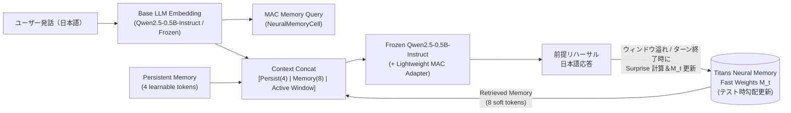

# Phase 2 設計書: 既存小型日本語 LLM ＋ Titans (MAC) 1 本道チャットプロトタイプ

- **作成日**: 2026-11-26
- **目標**: 12 月中に、1 本道の会話で継続対話できる日本語チャット UI を動かす。新しいチャットを作らずに前提を覚え、上書きしながら会話できる状態を目指す。
- **前提**: 基礎実験（Exp 1〜3.5、[research_report_20261125.md](research_report_20261125.md)）で実証した知見をそのまま組み込む。

---

## 1. アーキテクチャ全体像（PLAN.md アプローチ 3）

ゼロから日本語能力を事前学習する代わりに、日本語対話力を持つ小型オープン LLM を凍結（Freeze）して使う。
その入力コンテキスト先頭に、Titans の MAC（Memory as a Context）モジュールを接続する。

### なぜこの構成か

1. **日本語の自然さを最初から確保する**
   - ベースモデルには `Qwen/Qwen2.5-0.5B-Instruct` を採用する。
   - fp16 / bf16 時の VRAM 使用量は約 1.5〜2GB に収まる。
   - Kaggle T4（16GB）で学習と推論の両方を余裕をもって実行できる。

2. **本物の Titans テスト時記憶（Test-Time Memorization）を組み込む**
   - 外部 RAG だけでなく、Titans 論文（arXiv:2501.00663）の核である Neural Memory（高速重み $M_t$）を隠れ空間に実装する。
   - 会話セグメントごとに Key / Value の予測誤差（Surprise = $\nabla_{M} \| M(k_t) - v_t \|^2$）を計算する。
   - モメンタム $S_t$ と忘却ゲート $\alpha_t$ を使い、$M_t$ をテスト時にリアルタイム更新する。
   - $M_t$ と会話ログはディスクに保存・復元できる。アプリを再起動しても、1 本道の記憶を引き継げる。

3. **Exp 3.5 の結論（CoT リハーサル＋古い思考の間引き）を反映する**
   - 応答はターン単位 CoT（`<think>...</think>`）を基本とする。
   - 重要な前提や変更点は、思考内でリハーサルする。
   - 短期ウィンドウが上限に達したら、古いターンを Titans Neural Memory $M_t$ に書き込む。
   - その後、まず古い `<think>` から順に間引く。最終的に古いターンをウィンドウ外へ押し出す。

---

## 2. 学習設計（Exp 3.5 の 2 段階 SFT を応用）

凍結した LLM は、初期状態では先頭に差し込まれた MAC メモリトークン（8 個の連続ベクトル）を読めない。
そこで MAC アダプタ（Memory 射影層・記憶ゲート・Persistent Memory・読出し射影）だけを学習させる。
必要に応じて、最小限の LoRA も併用できる。

### 記憶を使わざるを得ない学習タスク

- 学習エピソードの前半（Turn 0 のユーザー前提・目標・制約・好み、および途中の更新）は Titans Neural Memory $M_t$ にだけ流し込む。
- 最終ターンの短期プロンプトからは、これらの情報を意図的に外す。
- ベース LLM は、MAC メモリトークンから過去の前提や上書き後の値を読み取らない限り正解できない。
- この制約により、メモリの書き込み・上書き・読出しがエンドツーエンドで学習される。

### 2 段階カリキュラム（Kaggle T4 で約 20〜35 分目安）

- **Stage 1（前半 30%：フォーマット＆単一記憶ウォームアップ）**
  - 1〜2 スロットの日本語プロフィール記憶を扱う。
  - `<think>` リハーサルと日本語応答の型を先に習得させる。
- **Stage 2（後半 70%：複数スロット・記憶上書き・多ターン混合）**
  - 途中の前提変更（`更新:`）や雑談ディストラクタを挟んだ日本語対話を扱う。
  - 上書き記憶と最新前提の維持を学習させる。

---

## 3. UI 設計（1 本道チャット ＋ 記憶インスペクタ）

`phase2_llm_titans_chat/chat_app.py` で Gradio Web UI を提供する。
Gradio 未導入環境向けには CLI も用意する。

- **左ペイン（1 本道チャット）**
  - 「新しいチャット」ボタンは置かず、1 本の会話ストリームを継続する。
  - 検証用のリセットや記憶の保存・読込はサイドパネルに配置する。
  - `<think>` の表示 ON/OFF トグルを備える。
- **右ペイン（Titans 記憶モニター）**
  - 現在の短期ウィンドウ内ターン数と、Titans Neural Memory に圧縮済みのターン数を表示する。
  - 直近ターンの Surprise（驚き度）と忘却ゲート $\alpha_t$ を可視化する。
  - 記憶状態（`.pt`）の保存・復元ボタンを配置する。

---

## 4. ファイル構成

- `phase2_llm_titans_chat/titans_mac_adapter.py`: Titans Neural Memory（テスト時勾配更新）と MAC コンテキスト注入ラッパーを実装する。`Qwen2.5-0.5B-Instruct` と軽量テスト用モック LLM の両方に対応する。
- `phase2_llm_titans_chat/train_mac_adapter.py`: 2 段階 SFT 学習スクリプトと日本語記憶・上書き評価を実装する。
- `phase2_llm_titans_chat/chat_app.py`: Gradio Web UI と CLI に対応した 1 本道チャットアプリを実装する。
- `phase2_llm_titans_chat/phase2_titans_ja_chat.ipynb`: Kaggle T4 / Google Colab 向けの一括実行ノートブックである。学習から評価、Gradio 共有リンク起動までを順に実行する。
